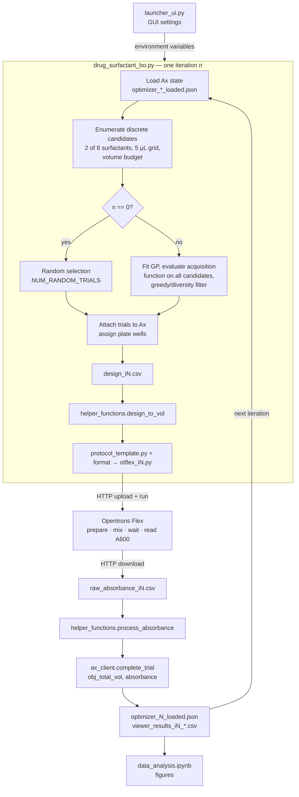

# Software Architecture

This document describes how the components of the drug–surfactant self-driving laboratory (SDL) fit together, how data flows through one closed-loop iteration, and what every generated file contains. For function-level details see [API.md](API.md).

## 1. Components

The software runs on two machines:

| Where | Component | File | Role |
|---|---|---|---|
| Host computer | Launcher GUI | `governing_files/launcher_ui.py` | Tkinter form that collects run settings, exports them as environment variables, and starts the BO loop as a subprocess, streaming its console output. |
| Host computer | BO orchestrator | `governing_files/drug_surfactant_bo.py` | Main script. Builds or reloads the Ax experiment, generates candidates, selects trials, writes the robot protocol, runs it, reads absorbance, and reports results back to Ax. |
| Host computer | Utilities | `governing_files/helper_functions.py` | Stock/total volume constants, design → pipetting-volume conversion, absorbance parsing, well-index arithmetic. |
| Host computer | Protocol template | `governing_files/protocol_template.py` | Opentrons Python API protocol with `{PLACEHOLDER}` fields. It is filled with `str.format()` each iteration; it is **not** imported on the host. |
| Host computer | Robot HTTP client | `governing_files/opentrons_http_client.py` | Thin wrappers around the Opentrons Flex HTTP API (upload protocol, create/start run, poll status, download data files). |
| Host computer | Run driver | `governing_files/opentrons_http_otflex_iA_mwe.py` | `run_otflex_iA()`: upload → analyse → create run → start → wait for completion. |
| Host computer | Labware definitions | `governing_files/*.json` | Custom labware uploaded together with every protocol. |
| Robot | Generated protocol | `<experiment>/protocols/otflex_iN.py` | Executed by the Opentrons Flex. It prepares the formulations, mixes them, and reads absorbance at 600 nm. |
| Host computer | Post-hoc analysis | `data_analysis/data_analysis_helper.py`, `data_analysis.ipynb` | Loads the saved Ax states and produces the figures (optimisation traces, GP response surfaces, SHAP). |

`opentrons_http_mwe.py` is a standalone minimal example of the HTTP workflow. The BO loop does not use it.

## 2. Closed-loop data flow

### Step-by-step (one iteration `n`)

1. **Resume state.** The iteration index `n` equals the number of `raw_data/raw_absorbance_i*.csv` files. The newest `optimizer/optimizer_*_loaded.json` is loaded if present. Otherwise a new Ax experiment is created.
2. **Choose the drug.** `drug = DRUG_CHOICES[n % len(DRUG_CHOICES)]`.
3. **Tighten the volume budget.** The best successful total surfactant volume so far for this drug (1200 µL if none) is reduced by `SURFACTANT_VOL_REDUCTION` %. This gives the upper limit for new candidates. The reduction is also applied in iteration 0, so the initial budget is 1080 µL.
4. **Enumerate candidates.** Every pair of the 8 surfactants (28 pairs) × both volumes on a 5 µL grid, with the pair's sum within the budget. Because the grid is built with `np.arange`, the sum can exceed a budget that is not a multiple of 5 µL by less than one grid step. Formulations that were already tested are removed.
5. **Select trials.**
   - *Iteration 0:* `NUM_RANDOM_TRIALS` candidates are drawn at random (seeded with `n`).
   - *Iteration ≥ 1:* the Ax `BOTORCH_MODULAR` GP is fitted, and the acquisition function is evaluated on every candidate. The best candidate per surfactant pair is kept and ranked. `TRIALS_PER_ITERATION` trials are then chosen using a diversity rule:
     - `high`: no surfactant may repeat.
     - `medium`: at most one shared surfactant.
     - `low`: pure top-k.

     The rule is scheduled by `GREEDY_HIGH`, `GREEDY_MEDIUM` and `GREEDY_LOW`.
6. **Register trials.** Each trial is attached to Ax and assigned plate wells (`REPLICATES` consecutive wells) and deep-well positions. If the plate fills, the loop stops after the current iteration.
7. **Generate the protocol.** Volumes are computed with `design_to_vol`, then injected into `protocol_template.py` together with tip and well start positions, replicates and delay time.
8. **Run on the robot.** The protocol and labware are uploaded over HTTP, run, and polled until finished. The absorbance CSV written by the Absorbance Reader is then downloaded.
9. **Evaluate.** Replicate absorbances are averaged. A trial succeeds if absorbance ≤ `ABSORBANCE_THRESHOLD`. The objective `obj_total_vol` is the total surfactant volume, multiplied by `PUNISHMENT_FACTOR` for failed trials. Both `obj_total_vol` and `absorbance` (used as an outcome constraint) are reported to Ax.
10. **Persist.** The Ax state, the tip/well positions and a human-readable results CSV are saved. Any interruption can therefore be resumed from the last completed iteration.

### Smoke-test mode

With `SMOKE_TEST=1`, the three robot functions (`run_otflex_iA`, `get_run_details`, `download_data_file`) are replaced by in-script mocks at the top of `drug_surfactant_bo.py`. The mock absorbance is a deterministic function of the surfactant volumes. Everything else, including GP fitting, acquisition, protocol generation and result processing, runs unchanged, and output is written to `smoketest_output/` with a `_smoketest` suffix.

## 3. Optimisation problem (as declared in Ax)

| Item | Definition |
|---|---|
| Parameters | `s1`…`s8`: volume (µL) of each surfactant stock, continuous in [0, 1200]; `drug`: choice {IBP, LOV, DCF, GLV} |
| Linear constraint | `s1 + … + s8 ≤ 1200` µL |
| Objective | minimise `obj_total_vol` (total surfactant volume, penalised if cloudy) |
| Outcome constraint | `absorbance ≤ ABSORBANCE_THRESHOLD` (600 nm) |
| Surrogate / acquisition | Ax `Models.BOTORCH_MODULAR` defaults, which in ax-platform 0.4.3 resolve to a BoTorch `SingleTaskGP` (one output each for `obj_total_vol` and `absorbance`; RBF kernel with ARD and a dimension-scaled LogNormal lengthscale prior; inputs normalised to [0, 1], outputs standardised) with `qLogNoisyExpectedImprovement` |
| Candidate set actually evaluated | two non-zero surfactants, 5 µL resolution, total ≤ current budget (650,160 candidates per drug in iteration 0, with a 1080 µL budget) |

The surfactant indices map to: s1 SDS, s2 sodium cholate, s3 CHAPS, s4 DTAB, s5 TTAB, s6 Poloxamer 188, s7 Poloxamer 407, s8 SB3-12. This mapping is defined in `data_analysis/data_analysis_helper.py`.

## 4. Robot deck layout (from `protocol_template.py`)

| Slot | Labware / module | Contents |
|---|---|---|
| A1 | Flex 96 filter tip rack 1000 µL | overflow rack (rack id `1`) |
| B1 | Flex 96 filter tip rack 1000 µL | default rack (rack id `0`) |
| A2 | Flex 96 filter tip rack 50 µL | |
| C1 | `allenlab_8_wellplate_20000ul` | surfactant stocks s1–s4 in A1–A4, s5–s8 in B1–B4 |
| C2 | `allenlab_8_wellplate_20000ul` | drug stocks IBP B1, LOV B2, DCF B3, GLV B4 |
| C3 | `agilent_1_reservoir_290ml` | water |
| B2 | `corning_96_wellplate_360ul_flat_new` | experimental (read-out) plate |
| D1 | Heater-Shaker V1 + universal flat adapter | deep-well (mixing) plate, `corning_96_wellplate_360ul_flat_new` |
| B3 | Absorbance Reader V1 | single-wavelength read at 600 nm |
| — | Waste chute | tips |

Pipettes: `flex_1channel_1000` on the left mount (volumes > 40 µL), `flex_1channel_50` on the right mount (volumes ≤ 40 µL). Robot API level 2.27.

## 5. Experiment folder and file formats

A new experiment folder is created by copying `experiments_template/`. Files with suffix `N` belong to iteration `N`.

| File | Written | Content |
|---|---|---|
| `experiment_parameters.csv` | start of run | Two columns `Variable Name,Value` holding all run settings |
| `tip_positions.json` | every iteration | `{"rack_id_1000", "well_1000", "well_50"}`: next unused tips |
| `well_positions.json` | every iteration | `{"plate", "deepplate"}`: next free wells |
| `optimizer/design_iN.csv` | before the run | One row per trial: `trial_index, drug_name, well_slot, deep_well_slot, rack_1000, well_1000, well_50, replicates, s1…s8, total_vol, obj_total_vol` (volumes in µL) |
| `optimizer/optimizer_N.json` | before the run | Ax client state with trials of iteration N attached (pending) |
| `optimizer/optimizer_N_loaded.json` | after the run | Ax client state with iteration N completed. It is used for resuming and for analysis. |
| `optimizer/snapshots/*_pending.json` | experiment creation | Ax state right after the experiment was created |
| `protocols/otflex_iN.py` | before the run | The exact protocol sent to the robot |
| `raw_data/raw_absorbance_iN.csv` | after the run | 8 × 12 matrix of A600 values (rows A–H, columns 1–12) |
| `results/viewer_results_iN_<timestamp>.csv` | after the run | Per-trial table for iteration N: design columns plus `original_total_vol, reported_vol, success, absorbance, prior_best_vol, is_new_record, status` |
